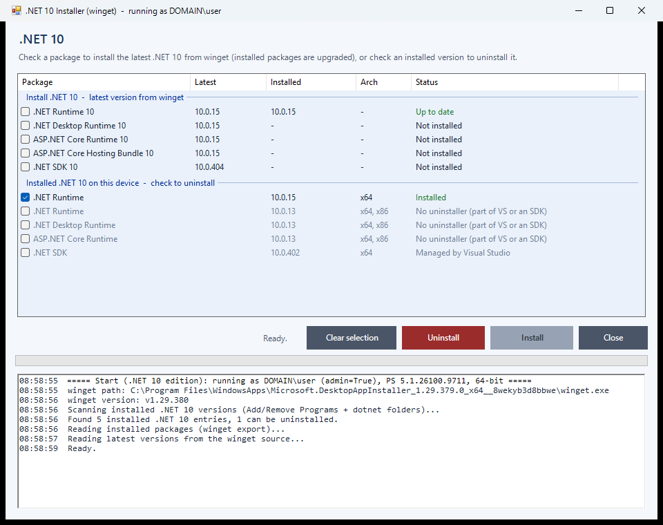
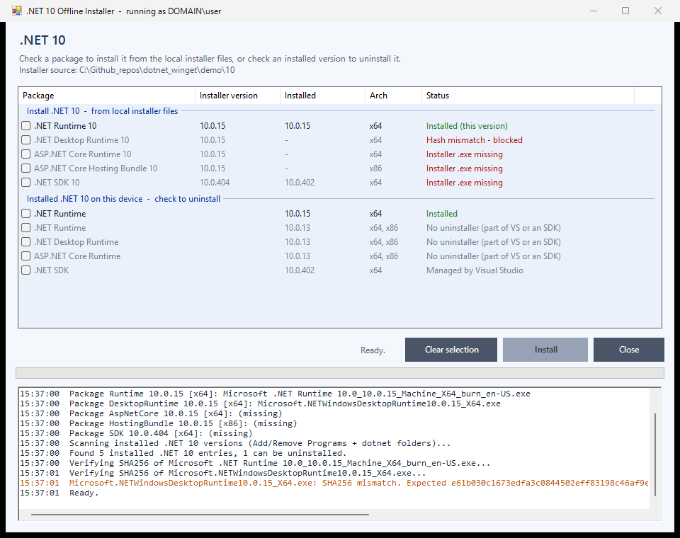

# DotNet-Installer

A PowerShell GUI that installs or upgrades Microsoft .NET 6, 8, 9 and 10 packages with **winget**. It is built to be deployed as a Configuration Manager (SCCM/MECM) application that runs as SYSTEM, while the logged-on user picks which packages to install.


## Files

| File | Purpose |
| --- | --- |
| `Install-DotNetWinget.ps1` | The original installer: a Windows Forms GUI, or a headless mode for unattended installs. It can install .NET 6, 8, 9 and 10. |
| `Detect-DotNetWinget.ps1` | ConfigMgr detection script that reads the registry marker the installer writes. |
| `Install-DotNet10Winget.ps1` | **.NET 10 edition.** Installs, upgrades and uninstalls .NET 10 only. See [.NET 10 / .NET 11 editions](#net-10--net-11-editions). |
| `Detect-DotNet10Winget.ps1` | Detection script for the .NET 10 edition. |
| `Install-DotNet11Winget.ps1` | **.NET 11 edition.** Installs, upgrades and uninstalls .NET 11 only. |
| `Detect-DotNet11Winget.ps1` | Detection script for the .NET 11 edition. |
| `10/Install-DotNet10Offline.ps1` | **.NET 10 offline edition.** Installs .NET 10 from local `.exe` installers (no winget), with GUI and headless modes. See [.NET 10 offline installer](#net-10-offline-installer-no-winget). |
| `10/Detect-DotNet10Offline.ps1` | Detection script for the GUI deployment of the offline edition. |

## Supported packages

For each .NET major version (**10, 9, 8, 6**), the GUI lists five winget packages:

| Product | Winget ID pattern |
| --- | --- |
| .NET Runtime | `Microsoft.DotNet.Runtime.<major>` |
| .NET Desktop Runtime | `Microsoft.DotNet.DesktopRuntime.<major>` |
| ASP.NET Core Runtime | `Microsoft.DotNet.AspNetCore.<major>` |
| ASP.NET Core Hosting Bundle | `Microsoft.DotNet.HostingBundle.<major>` |
| .NET SDK | `Microsoft.DotNet.SDK.<major>` |

.NET 6 is labelled *out of support* in the GUI. To change the versions or products, edit the `$Majors`, `$Products` and `$OutOfSupport` values in the **Configuration** region at the top of the script.

## How it works

1. **Startup and logging**
   - The script opens a log file in CMTrace format, `DotNetWingetInstaller.log`. It uses the first folder it can write to: `%windir%\CCM\Logs`, then `%ProgramData%\DotNetWingetInstaller\Logs`, then `%TEMP%`.
   - It records who the script runs as and whether it is elevated. When it is not elevated, each install shows a UAC prompt.

2. **Finding winget**
   - The SYSTEM account has no `winget` alias on its PATH. So the script searches `Program Files\WindowsApps\Microsoft.DesktopAppInstaller_*_8wekyb3d8bbwe\winget.exe`, uses the newest version it finds, and only falls back to `winget.exe` on PATH if that search finds nothing.
   - It then runs `winget --version` to check that winget starts. If winget is missing or cannot start (often because a dependency such as VCLibs or UI.Xaml is missing for SYSTEM), the script shows an error and exits with code `1`.

3. **Reading versions (background thread)**
   - The installed versions come from `winget export --include-versions`. This returns clean JSON and avoids the column truncation in `winget list`.
   - The latest available version of each package comes from `winget show --id <Id> --exact --source winget`.
   - Each row then gets a status: **Up to date**, **Update available**, **Not installed** or **Not found in winget**.

4. **Selecting and installing**
   - The user checks the packages they want and clicks **Install selected**, then confirms.
   - The packages install one at a time, silently:
     ```
     winget install --id <Id> --exact --source winget --silent
            --accept-package-agreements --accept-source-agreements
            --disable-interactivity --log <LogDir>\winget_<Id>_<timestamp>.log
     ```
   - If a package is already installed, `winget install` upgrades it to the latest version.
   - While packages install, the progress bar, the status column and the log pane update live. The window cannot be closed until the batch finishes.
   - When the batch finishes, the script reads the installed versions again and shows a summary.

5. **Result mapping**
   - Each winget exit code is mapped to one of these results:

     | Winget exit code | Result |
     | --- | --- |
     | `0` | Installed |
     | `0x8A15002B`, `0x8A150061`, `0x8A15010D` | Already up to date |
     | `0x8A150109`, `0x8A15010A`, `3010`, `1641` | Installed, reboot required |
     | anything else | Failed |

6. **Exit code and detection marker**
   - When the window closes, the script exits with the overall result:

     | Exit code | Meaning |
     | --- | --- |
     | `0` | Success, or nothing to do |
     | `3010` | Success, reboot required |
     | `1603` | One or more packages failed |
     | `1` | winget could not be used |

   - On `0` or `3010`, the script writes `LastRunUtc`, `LastExitCode` and `LastPackages` to `HKLM\SOFTWARE\DotNetWingetInstaller`.

### Threading model

WinForms runs on the main thread. The two slow jobs, reading versions and installing packages, run in separate STA runspaces, so the window stays responsive. The background threads share state with the window through a synchronized hashtable and send their log lines and row updates through a `ConcurrentQueue`. A 200 ms UI timer takes items off that queue and applies them to the window.

## Usage

### Interactive (GUI)

```powershell
powershell.exe -ExecutionPolicy Bypass -NoProfile -WindowStyle Hidden -File .\Install-DotNetWinget.ps1
```

### Headless / unattended

Pass one or more winget IDs to skip the GUI. Log output goes to the console and to the log file.

```powershell
.\Install-DotNetWinget.ps1 -PackageId Microsoft.DotNet.Runtime.8,Microsoft.DotNet.DesktopRuntime.8
```

## ConfigMgr deployment

1. Create an application with a **Script Installer** deployment type.
2. **Install program:** `powershell.exe -ExecutionPolicy Bypass -NoProfile -WindowStyle Hidden -File .\Install-DotNetWinget.ps1`
3. **User experience:** *Install for system*, *Whether or not a user is logged on* (or *Only when a user is logged on*), and enable **Allow users to view and interact with the program installation**.
4. **Return codes:** keep the defaults (`0` success, `3010` soft reboot, `1603` failure) and add `1` as a failure.
5. **Detection method:** use the custom script `Detect-DotNetWinget.ps1`.

### How detection works

`Detect-DotNetWinget.ps1` reports the application as **installed** only for 60 minutes after a successful run, based on `LastRunUtc`. That window is set by `$WindowMinutes`. Because of this, Software Center shows the app as installed right after a run, and users can launch it again later to install more packages or pick up updates.

## .NET 10 / .NET 11 editions

`Install-DotNet10Winget.ps1` and `Install-DotNet11Winget.ps1` are the same script. They differ only in `$TargetMajor`, at the top of the file. Each edition works with **only its own .NET version**. Other .NET versions cannot be installed, and they are not listed.

The window has a single list with two groups:

- **Install .NET 10 (or 11):** the five winget packages (Runtime, Desktop Runtime, ASP.NET Core Runtime, Hosting Bundle, SDK). Each row shows the latest version in winget and the installed version. Check one or more packages and click **Install**. Packages that are already installed are upgraded to the latest version.
- **Installed .NET 10 (or 11) on this device:** every 10.x (or 11.x) runtime, Hosting Bundle and SDK already on the device. Checking an installed entry shows the red **Uninstall** button.



<details><summary>.NET 11 edition</summary>


</details>

### How installed versions are found

1. **Add/Remove Programs:** The script reads the uninstall registry keys, both 64-bit and `WOW6432Node`. It keeps only the visible .NET bundle entries of the target version and skips the hidden `SystemComponent` MSI parts.
2. **Files on disk:** The script lists `Program Files\dotnet\shared\*` and `\sdk`, plus the `(x86)` folders. A runtime or SDK of the target version that no uninstall entry accounts for is shown as **No uninstaller (part of VS or an SDK)**.

| Installed entry | Checkbox |
| --- | --- |
| Standalone install (Runtime, Desktop Runtime, ASP.NET Core, Hosting Bundle, SDK) | ✅ Can be uninstalled |
| SDK installed by Visual Studio ("from Visual Studio") | ⬜ Information only. Remove it with the Visual Studio Installer. |
| Files on disk with no uninstall entry | ⬜ Information only. Remove it with the product that installed it. |

Uninstalling runs the entry's registered `QuietUninstallString` with `/norestart /log <LogDir>\uninstall_*.log`. For an MSI entry it runs `msiexec /x {GUID} /qn /norestart`. Exit codes `1605`/`1614` (product not installed) count as *already uninstalled*. After each batch, the list is scanned again.

### Colour scheme

The window uses a light body, a pale blue package list with dark text, and dark buttons with white text: navy for **Install**, red for **Uninstall** and slate for **Clear selection** and **Close**. All colours are hex values in the `$Theme` table at the top of the script.

### Usage

```powershell
# GUI
powershell.exe -ExecutionPolicy Bypass -NoProfile -WindowStyle Hidden -File .\Install-DotNet10Winget.ps1

# Headless install (only .NET 10 IDs are accepted)
.\Install-DotNet10Winget.ps1 -PackageId Microsoft.DotNet.Runtime.10,Microsoft.DotNet.DesktopRuntime.10
```

Each edition writes its own log (`DotNet10WingetInstaller.log` / `DotNet11WingetInstaller.log`) and its own detection marker (`HKLM\SOFTWARE\DotNetWingetInstaller\NET10` / `NET11`). Use the matching `Detect-DotNet10Winget.ps1` / `Detect-DotNet11Winget.ps1` as the ConfigMgr detection script. The exit codes are the same as in the original script.

## .NET 10 offline installer (no winget)

`10/Install-DotNet10Offline.ps1` installs .NET 10 from `.exe` installer files stored next to the script, instead of downloading them with winget. It uses the same single-list GUI, colours and uninstall feature as the winget .NET 10 edition.



*This screenshot is from a test setup. The Runtime installer was present and passed its hash check. The Desktop Runtime `.exe` was replaced with a dummy file, which was blocked by the hash check. The other three installers were not staged.*

### Folder layout

There is one subfolder per package, named `<PackageIdentifier>_<Version>`. Each subfolder holds the package's winget YAML manifest and its installer:

```
10\
  Install-DotNet10Offline.ps1
  Detect-DotNet10Offline.ps1
  Microsoft.DotNet.Runtime.10_10.0.15\
    Microsoft .NET Runtime 10.0_10.0.15_Machine_X64_burn_en-US.yaml
    Microsoft .NET Runtime 10.0_10.0.15_Machine_X64_burn_en-US.exe
  Microsoft.DotNet.DesktopRuntime.10_10.0.15\
  Microsoft.DotNet.AspNetCore.10_10.0.15\
  Microsoft.DotNet.HostingBundle.10_10.0.15\
  Microsoft.DotNet.SDK.10_10.0.404\
```

- **Installers are not stored in git.** `*.exe` is listed in `.gitignore`, because the SDK installer is larger than GitHub's 100 MB file limit. Copy the installers into each folder of your ConfigMgr content source. The download URL for each one is the `InstallerUrl` in its YAML.
- **How the script picks the `.exe`:** It uses the file with the same name as the YAML. If there is no such file, it uses the only `.exe` in the folder. If there are several, it uses the one whose hash matches the YAML.
- **What the script reads from the YAML:** the package version, architecture, `InstallerSha256`, `ProductCode`, installer switches (`/quiet`, `/norestart`, `/log`) and the meaning of each return code (for logging).
- **To update to a new patch,** replace the folder (and its YAML and `.exe`) with the new version. If there are several folders for the same package, the script uses the one with the newest version.

### Hash verification

Before an installer runs, its SHA256 is compared with `InstallerSha256` from the YAML. The check runs when the GUI loads and again just before each install. An installer that doesn't match shows **Hash mismatch - blocked** and is not run. `-SkipHashCheck` overrides this, but it's not recommended.

Each install runs as:

```
"<installer>.exe" /install /quiet /norestart /log "<LogDir>\install_<Package>_<Version>_<timestamp>.log"
```

Exit codes `0` (success), `3010`/`1641` (reboot required) and `1638` (already installed) count as success.

### GUI

The **Install .NET 10** group lists the five packages, each with the installer version, the installed version and a status:

| Status | Meaning |
| --- | --- |
| Installed (this version) | The installer's `ProductCode` is already registered. |
| Update available / Newer version installed / Installed | Compares the installer's version with the highest installed version of that product. |
| Not installed | No version of that product is installed. |
| Installer .exe missing | The folder has no installer, so the row can't be checked. |
| Hash mismatch - blocked | The installer's hash doesn't match the YAML, so the row can't be checked. |

The **Installed .NET 10 on this device** group and the **Uninstall** button work the same way as in the winget .NET 10 edition.

### Headless mode (one ConfigMgr deployment type per package)

| Parameter | Description |
| --- | --- |
| `-Install <names>` | Install the named packages. |
| `-Uninstall <names>` | Uninstall every standalone .NET 10 installation of the named products: all patch versions and architectures. Entries managed by Visual Studio are skipped. |
| `-SkipHashCheck` | Run installers even when their hash doesn't match the YAML. |
| `-SourcePath <folder>` | Read installers from another folder. Default: the script's own folder. |

Package names are `Runtime`, `DesktopRuntime`, `AspNetCore`, `HostingBundle`, `SDK` and `All`. Separate several names with commas. Commas work with `powershell.exe -File`. When both parameters are given, uninstalls run first.

```powershell
# ConfigMgr deployment type "Runtime 10"
#   Install program:
powershell.exe -ExecutionPolicy Bypass -NoProfile -WindowStyle Hidden -File .\Install-DotNet10Offline.ps1 -Install Runtime
#   Uninstall program:
powershell.exe -ExecutionPolicy Bypass -NoProfile -WindowStyle Hidden -File .\Install-DotNet10Offline.ps1 -Uninstall Runtime

# Several packages at once
powershell.exe -ExecutionPolicy Bypass -NoProfile -File .\Install-DotNet10Offline.ps1 -Install Runtime,DesktopRuntime,AspNetCore
```

**Detection for per-package deployment types:** Use a registry detection rule that checks whether the package's `ProductCode` key (from its YAML) exists. The installers are 32-bit bundles, so the key is under `HKLM\SOFTWARE\WOW6432Node\Microsoft\Windows\CurrentVersion\Uninstall\<ProductCode>`. For example, the Runtime 10.0.15 key is `{E3860B64-C6F7-43B8-8809-CEE4AE78D57D}`.

**Detection for the GUI deployment:** Use `10/Detect-DotNet10Offline.ps1`. It reads the marker that the script writes to `HKLM\SOFTWARE\DotNetOfflineInstaller\NET10`.

The log is `DotNet10OfflineInstaller.log`, in the same log folder as the other scripts. The exit codes are the same as in the other scripts. `1` also means invalid package names or that no installer folders were found.
## Requirements

- Windows 10/11 with **App Installer (winget)** provisioned for the device.
- Windows PowerShell 5.1.
- Administrator rights or SYSTEM context to install without UAC prompts.

## License

See [LICENSE](LICENSE).
