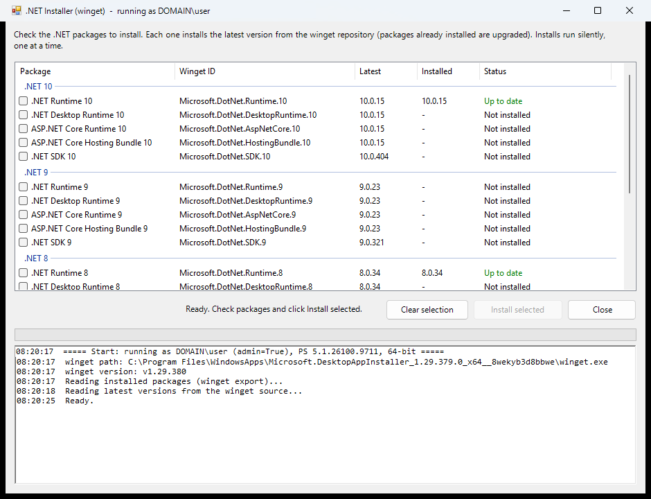

# DotNet-Installer

A PowerShell GUI that installs or upgrades Microsoft .NET 6, 8, 9 and 10 packages with **winget**. It is built to be deployed as a Configuration Manager (SCCM/MECM) application that runs as SYSTEM, while the logged-on user picks which packages to install.



## Files

| File | Purpose |
| --- | --- |
| `Install-DotNetWinget.ps1` | The installer: a Windows Forms GUI, or a headless mode for unattended installs. |
| `Detect-DotNetWinget.ps1` | ConfigMgr detection script that reads the registry marker the installer writes. |

## Supported packages

For each .NET major version (**10, 9, 8, 6**), the GUI lists five winget packages:

| Product | Winget ID pattern |
| --- | --- |
| .NET Runtime | `Microsoft.DotNet.Runtime.<major>` |
| .NET Desktop Runtime | `Microsoft.DotNet.DesktopRuntime.<major>` |
| ASP.NET Core Runtime | `Microsoft.DotNet.AspNetCore.<major>` |
| ASP.NET Core Hosting Bundle | `Microsoft.DotNet.HostingBundle.<major>` |
| .NET SDK | `Microsoft.DotNet.SDK.<major>` |

.NET 6 is labelled *out of support* in the GUI. To change the versions or products, edit the `$Majors`, `$Products` and `$OutOfSupport` values in the **Configuration** region at the top of the script.

## How it works

1. **Startup and logging**
   - The script opens a log file in CMTrace format, `DotNetWingetInstaller.log`. It uses the first folder it can write to: `%windir%\CCM\Logs`, then `%ProgramData%\DotNetWingetInstaller\Logs`, then `%TEMP%`.
   - It records who the script runs as and whether it is elevated. When it is not elevated, each install shows a UAC prompt.

2. **Finding winget**
   - The SYSTEM account has no `winget` alias on its PATH. So the script searches `Program Files\WindowsApps\Microsoft.DesktopAppInstaller_*_8wekyb3d8bbwe\winget.exe`, uses the newest version it finds, and only falls back to `winget.exe` on PATH if that search finds nothing.
   - It then runs `winget --version` to check that winget starts. If winget is missing or cannot start (often because a dependency such as VCLibs or UI.Xaml is missing for SYSTEM), the script shows an error and exits with code `1`.

3. **Reading versions (background thread)**
   - The installed versions come from `winget export --include-versions`. This returns clean JSON and avoids the column truncation in `winget list`.
   - The latest available version of each package comes from `winget show --id <Id> --exact --source winget`.
   - Each row then gets a status: **Up to date**, **Update available**, **Not installed** or **Not found in winget**.

4. **Selecting and installing**
   - The user checks the packages they want and clicks **Install selected**, then confirms.
   - The packages install one at a time, silently:
     ```
     winget install --id <Id> --exact --source winget --silent
            --accept-package-agreements --accept-source-agreements
            --disable-interactivity --log <LogDir>\winget_<Id>_<timestamp>.log
     ```
   - If a package is already installed, `winget install` upgrades it to the latest version.
   - While packages install, the progress bar, the status column and the log pane update live. The window cannot be closed until the batch finishes.
   - When the batch finishes, the script reads the installed versions again and shows a summary.

5. **Result mapping**
   - Each winget exit code is mapped to one of these results:

     | Winget exit code | Result |
     | --- | --- |
     | `0` | Installed |
     | `0x8A15002B`, `0x8A150061`, `0x8A15010D` | Already up to date |
     | `0x8A150109`, `0x8A15010A`, `3010`, `1641` | Installed, reboot required |
     | anything else | Failed |

6. **Exit code and detection marker**
   - When the window closes, the script exits with the overall result:

     | Exit code | Meaning |
     | --- | --- |
     | `0` | Success, or nothing to do |
     | `3010` | Success, reboot required |
     | `1603` | One or more packages failed |
     | `1` | winget could not be used |

   - On `0` or `3010`, the script writes `LastRunUtc`, `LastExitCode` and `LastPackages` to `HKLM\SOFTWARE\DotNetWingetInstaller`.

### Threading model

WinForms runs on the main thread. The two slow jobs, reading versions and installing packages, run in separate STA runspaces, so the window stays responsive. The background threads share state with the window through a synchronized hashtable and send their log lines and row updates through a `ConcurrentQueue`. A 200 ms UI timer takes items off that queue and applies them to the window.

## Usage

### Interactive (GUI)

```powershell
powershell.exe -ExecutionPolicy Bypass -NoProfile -WindowStyle Hidden -File .\Install-DotNetWinget.ps1
```

### Headless / unattended

Pass one or more winget IDs to skip the GUI. Log output goes to the console and to the log file.

```powershell
.\Install-DotNetWinget.ps1 -PackageId Microsoft.DotNet.Runtime.8,Microsoft.DotNet.DesktopRuntime.8
```

## ConfigMgr deployment

1. Create an application with a **Script Installer** deployment type.
2. **Install program:** `powershell.exe -ExecutionPolicy Bypass -NoProfile -WindowStyle Hidden -File .\Install-DotNetWinget.ps1`
3. **User experience:** *Install for system*, *Whether or not a user is logged on* (or *Only when a user is logged on*), and enable **Allow users to view and interact with the program installation**.
4. **Return codes:** keep the defaults (`0` success, `3010` soft reboot, `1603` failure) and add `1` as a failure.
5. **Detection method:** use the custom script `Detect-DotNetWinget.ps1`.

### How detection works

`Detect-DotNetWinget.ps1` reports the application as **installed** only for 60 minutes after a successful run, based on `LastRunUtc`. That window is set by `$WindowMinutes`. Because of this, Software Center shows the app as installed right after a run, and users can launch it again later to install more packages or pick up updates.

## Requirements

- Windows 10/11 with **App Installer (winget)** provisioned for the device.
- Windows PowerShell 5.1.
- Administrator rights or SYSTEM context to install without UAC prompts.

## License

See [LICENSE](LICENSE).
